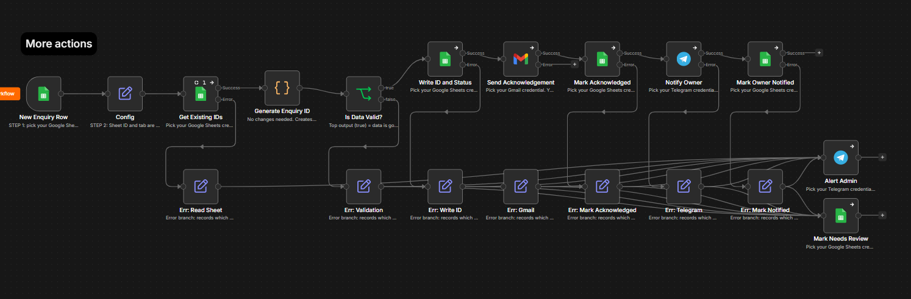
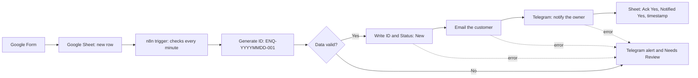
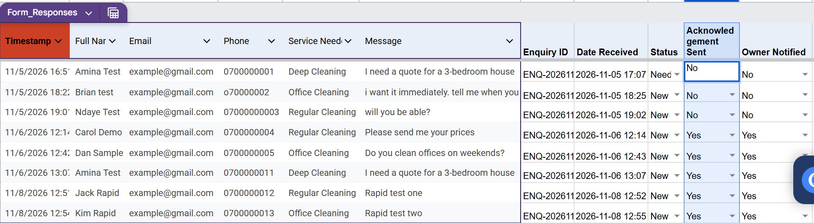
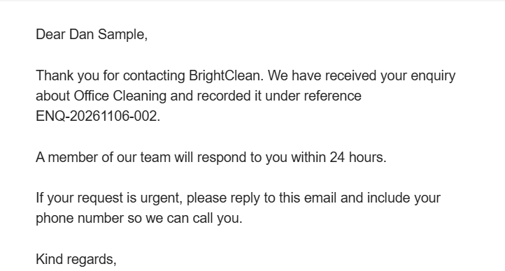
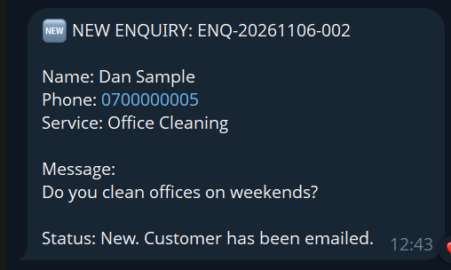
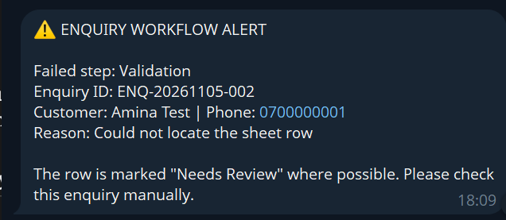

<!--
HOW TO EDIT THIS README
1. Search this file for "ADD:" (Ctrl+F). Every placeholder starts with "ADD:" and sits inside square brackets.
2. Replace each [ADD: ...] with your own text, link or image, then delete the brackets.
3. Create a folder called "images" in your repo and upload your screenshots there, with the file names shown below.
4. When no "ADD:" is left, delete this comment block.
-->

# Customer Enquiry Management System

> An n8n automation that records every customer enquiry, acknowledges the customer within about a minute, and alerts the business owner on Telegram.

**Built by:** Mayombwe David | **Demo video:** [ADD: link to your 60-90 second demo video] | **Demo business:** BrightClean (fictional cleaning company)

*[ADD: upload a screenshot of your full n8n workflow canvas as images/01-workflow-canvas.png]*

## Business Problem

Small businesses lose customers when enquiries are answered late, never logged, or forgotten. The owner needs every enquiry recorded in one place, the customer told straight away that their message was received, and the owner notified so they can respond quickly.

For example, a small cleaning company receives enquiries by phone, WhatsApp and email. Some are answered a day late, some are written on paper and lost, and the owner never knows how many customers were missed.

## Tools Used

| Tool | Role |
|---|---|
| Google Forms | Enquiry intake |
| Google Sheets | Database and status tracking |
| n8n (self-hosted) | Workflow automation |
| Gmail | Customer acknowledgement email |
| Telegram | Owner notification and error alerts |
| Claude (Anthropic) | AI assistant used to design, build and debug (see [How AI Was Used](#how-ai-was-used)) |

## How It Works

1. A customer submits the Google Form (name, email, phone, service needed, message).
2. The response is added as a new row in Google Sheets.
3. n8n detects the new row (it checks every minute).
4. n8n generates a unique ID in the format `ENQ-YYYYMMDD-001` (East Africa Time). The counter restarts each day.
5. n8n validates the data: valid email, name not empty, message not empty.
6. If valid, the ID is written to the Sheet with Status = **New**.
7. The customer receives a professional email with their name, the service requested and a 24-hour response promise.
8. The owner receives a Telegram message with the ID, name, phone, service and message.
9. The Sheet is updated: Acknowledgement Sent = Yes, Owner Notified = Yes, Last Updated = current timestamp.
10. If validation or any step fails, the admin gets a Telegram alert naming the failed step and the enquiry ID, and the row is marked **Needs Review**.

**Status values:** New, Contacted, Quoted, Won, Lost, Needs Review.

### Google Sheet columns

| Column | Filled by |
|---|---|
| Timestamp, Full Name, Email, Phone, Service Needed, Message | Google Form |
| Enquiry ID, Date Received | n8n |
| Status | n8n sets New or Needs Review; the owner updates it to Contacted, Quoted, Won or Lost |
| Acknowledgement Sent, Owner Notified, Last Updated | n8n |

### Screenshots

| Step | Screenshot |
|---|---|
| The enquiry form |  *[ADD: screenshot of the Google Form]* |
| The Sheet after processing |  *[ADD: screenshot of the Sheet with ID, Status, Yes / Yes. Hide real emails.]* |
| Acknowledgement email |  *[ADD: screenshot of the customer email]* |
| Owner notification |  *[ADD: screenshot of the Telegram message. Hide chat IDs.]* |
| Error alert |  *[ADD: screenshot of a failure alert]* |

### Example messages (fake data)

**Acknowledgement email**

> Dear Kim Rapid,
> Thank you for contacting BrightClean. We have received your enquiry about Office Cleaning and recorded it under reference ENQ-20261108-002.
> A member of our team will respond to you within 24 hours.
> If your request is urgent, please reply to this email and include your phone number so we can call you.
> Kind regards, Mayombwe David, BrightClean

**Telegram message to the owner**

> NEW ENQUIRY: ENQ-20261108-002
> Name: Kim Rapid | Phone: 0700000013 | Service: Office Cleaning
> Message: Rapid test two
> Status: New. Customer has been emailed.

**Failure alert**

> ENQUIRY WORKFLOW ALERT
> Failed step: Validation | Enquiry ID: ENQ-20261106-004
> Reason: Full Name is empty

## Test Results

Tested with fake data only, on 5 to 8 November 2026. Result: **10 of 10 tests passed**.

Valid enquiries that went through the live Google Form were acknowledged and logged within **18 to 47 seconds** (3 automatic runs, measured from Form submission to the final Sheet update). Tests marked "Sheet" were added directly to the Sheet in one write, because the Form blocks blank fields and invalid emails.

| # | Test | Method | Expected result | Actual result | Pass / Fail |
|---|---|---|---|---|---|
| 1 | Valid enquiry | Form | ID created, status New, email and Telegram sent, Sheet shows Yes / Yes | ID `ENQ-20261106-003`, email and Telegram received, Sheet Yes / Yes | Pass |
| 2 | Second valid enquiry, same day | Sheet | Next ID, all steps succeed | ID `ENQ-20261106-008`, all steps succeeded | Pass |
| 3 | Valid, Phone blank | Sheet | Passes; Telegram shows "Not provided" | ID `-009`, Telegram showed "Phone: Not provided", email sent | Pass |
| 4 | Blank Full Name | Sheet | Needs Review, validation alert, no emails | ID `-004`, alert "Full Name is empty", status Needs Review, no email | Pass |
| 5 | Blank Message | Sheet | Needs Review, validation alert | ID `-005`, alert "Message is empty", status Needs Review | Pass |
| 6 | Blank Email | Sheet | Needs Review, validation alert | ID `-006`, alert "Email is empty", status Needs Review | Pass |
| 7 | Invalid email (`grace.invalid@`) | Sheet | Needs Review, validation alert | ID `-007`, alert "Email is not valid", status Needs Review | Pass |
| 8 | Very long message (about 3,000 characters) | Sheet | Succeeds; Telegram text shortened; Sheet keeps full text | ID `-010`; Telegram cut at 500 characters with "(full text in Sheet)"; email sent | Pass |
| 9 | Special characters and emoji | Sheet | Succeeds with no formatting errors | ID `-011`; text appeared exactly as typed in Telegram and email | Pass |
| 10 | Two submissions back to back | Form | Two different consecutive IDs | `ENQ-20261108-001` and `-002` (about 3 minutes apart); no duplicates. Simultaneous rows were also processed in one batch in tests 4 to 7, with consecutive unique IDs | Pass |

## How AI Was Used

I built this project with Claude (Anthropic) as an AI assistant. I want to be clear about who did what.

**My work**
- I defined the business problem, the requirements and the 8-step logic.
- I created the Google Form and Sheet, the Google Cloud app (Gmail and Sheets access), the Telegram bot, and the credentials in my own self-hosted n8n.
- I imported and configured the workflow, ran the tests, and reported exact error messages when something failed.
- I checked each node's settings and credentials, and chose the demo business (BrightClean) and its example services.

**What Claude did**
- Drafted the node-by-node plan and flagged design risks before building.
- Generated the importable workflow JSON, the email and Telegram templates, the setup guide, the test plan and the first README draft.
- Helped diagnose errors, and used a Google Sheets connection to check my Sheet's headers and formats.
- Added the Config node and the "skip rows that already have an ID" check after problems found in testing.

**Problems found while testing, and how they were fixed**

| Problem | Cause | Fix |
|---|---|---|
| Nodes said "credentials not set" after import | The generated JSON contained placeholder credential links | Removed them; selected my own credentials on each node |
| Email showed a blank business name | A label in the Config node was empty | Restored the `businessName` label |
| Gmail "too many requests" (429) right after connecting a new Google app | Google rate-limited a brand-new connection | Waited for Google's retry time; it then worked |
| Test mode re-processed old rows and raised "Could not locate the sheet row" | The trigger returns existing rows in test mode | Added a check that skips rows that already have an ID |
| Full Name header gained a trailing space after a Form edit | Editing the Form question changed the Sheet header | Corrected the header; avoid editing Form questions |
| A node showed "(Deactivated)" | It had been switched off in n8n | Re-activated it |
| New Form responses were missed | Test rows I added below the Form data made Forms insert responses mid-sheet | Moved test rows to a separate tab |

**What I learned:** An automation is only as reliable as its testing. Most problems only appeared when I ran real submissions, including blank fields and a very long message. I learned how OAuth connects n8n to Gmail and Google Sheets, how to read errors such as a 429 rate limit, and why every step needs an error path that says which step failed and for which enquiry.

## Run It Yourself

Tested on n8n 2.33.7 (self-hosted).

1. Create the Google Form and the linked Sheet, then add the extra columns (see `SETUP_AND_TESTING_GUIDE.md`).
2. Create your Google, Gmail and Telegram credentials in n8n.
3. Import `customer-enquiry-management-system.json` into n8n.
4. Select your credentials on each node, and fill in the Config node (Sheet ID, tab name, chat IDs, business name, owner name). Paste the same Sheet ID into the first node, **New Enquiry Row**.
5. Publish the workflow and submit a test enquiry.

**Files in this repository**
- `customer-enquiry-management-system.json`: importable n8n workflow (no credentials)
- `SETUP_AND_TESTING_GUIDE.md`: setup steps, message templates, test plan, troubleshooting, demo script
- `images/`: screenshots

## Limitations

- The workflow checks the Sheet about once a minute, so acknowledgements are not instant.
- Enquiries added while the workflow is switched off are not picked up automatically.
- Enquiry IDs are calculated by reading the Sheet. At high volume, two simultaneous submissions in separate runs could clash.
- If Telegram or Google Sheets is itself down, the failure alert or "Needs Review" mark may not go through.
- Failures before an ID exists (for example, the Sheet cannot be read) are reported as `UNASSIGNED`.
- Google Forms controls the first six Sheet columns, so the extra tracking columns sit to the right.
- The email is plain text, sent from a single Gmail account (free Gmail allows about 500 emails per day).
- Do not insert, sort or delete rows in the live Sheet while the workflow is running. The trigger watches the end of the Sheet, so rows inserted in the middle can be missed.
- Duplicate enquiries from the same customer are not detected.
- There is no automatic follow-up if the owner does not respond within 24 hours.

## Next Steps

- Add a daily Telegram summary of enquiries still marked New.
- Send a reminder to the owner if an enquiry stays New for more than 12 hours.
- Add duplicate detection (same email and message within 24 hours).
- Add a separate n8n Error Workflow as a safety net for failures before an ID exists.
- Add a branded HTML email template.
- Build a simple dashboard (Google Sheets chart or Looker Studio) showing enquiries by service and Won / Lost rates.
- Replace polling with a Google Forms or Apps Script webhook for instant triggering.

## About the Author

Mayombwe David, an aspiring virtual assistant focused on AI-powered administrative support and workflow automation.

- LinkedIn: https://www.linkedin.com/in/mayombwe-david/
- Portfolio: 
- Email: kagegere.intake@gmail.com
*All names, emails and phone numbers in this project are fake test data.*
